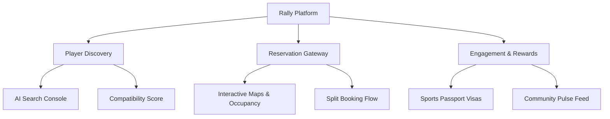

# 🏸 RALLY — FIND YOUR NEXT GAME
> *"Bringing people together."*

---

**Project Type**: Advanced Frontend Web Application  
**Developed By**: Sanskruti Yevankar  
**Tech Stack**: React 19 + TypeScript + Vite 8 + Tailwind CSS  
**Documentation Purpose**: Portfolio, Hackathon, College Project, Internship Evaluation  

---

## 1. Project Overview

**Rally** is an immersive, premium, and futuristic sports partner finder and court reservation platform. Built for the modern athlete, the platform addresses a growing social challenge: the difficulty of finding local game partners, coordinating match schedules, discovering nearby venues, and managing payment divisions.

Rally serves as a digital "Sports Visa," where players maintain active game credentials, level up through verified matches, and find partners matching their specific skill rating. By merging high-fidelity visual design with intuitive layouts, Rally transforms the coordination of recreational sports from a tedious planning task into an interactive, gamified journey.

**The Vision**: To create an AI-first, community-driven sports hub that breaks down social barriers, encourages active physical lifestyles, and builds strong micro-local sports communities.

---

## 2. Problem Statement

Recreational sports players face several friction points in daily planning:
1. **Difficulty Finding Game Partners**: Players often lack friends available at the same time or who share their specific sport interest.
2. **Skill Mismatch**: Matching with players of vastly different skill levels leads to poor game quality for both beginners and advanced players.
3. **Fragmented Venue Discovery**: Court availability, accessibility options, parking detail, and live weather conditions are rarely found in one single place.
4. **Fragmented Booking Systems**: Selecting court times, renting equipment, and sharing payment receipts typically require switching between multiple messaging and banking apps.
5. **Lack of Motivation (Gamification)**: Traditional platforms treat matchmaking as a utility list. There is no incentive system, XP progress, active streak trackers, or achievement badges to keep players motivated.

---

## 3. Proposed Solution

Rally addresses these problems by consolidating player discovery, court reservations, community logs, and custom AI scheduling into a unified, high-performance command center:



* **AI-First Search Console**: Translates natural language requests (e.g., *"football match this weekend"*) into filtered lists of compatible players and venues.
* **Compatibility Gauges**: Uses a visual matching algorithm comparing skill levels and availability.
* **Unified Reservation Gateway**: Timeline-based reservation wizard that manages date selection, equipment counts, and payment divisions.
* **Sports Passport**: A gamified player card showing active sport levels, Mon-Sun active calendars, skill parameters, and badge cabinets.
* **Interactive Venue Explorer**: Highlights weather suitability, parking access, wheelchair entrances, and live court occupancy.

---

## 4. Key Features

The core functionalities of Rally are categorized in the table below:

| Feature Area | Description |
| :--- | :--- |
| **Authentication** | Secure client-side credentials database with SHA-256 password hashing via Web Crypto Subtle API. |
| **Sports Selection** | Onboarding checklist to configure favorite sport profiles and cartoon avatar presets. |
| **Player Discovery** | Real-time matchmaking lists with compatibility gauges and proximity distance bounds. |
| **Venue Explorer** | Multi-sport venue explorer highlighting accessibility flags, weather alerts, and occupancy. |
| **Booking Flow** | 4-step wizard: Schedule selector, equipment counts, payment splits, and calendar sync alerts. |
| **Sports Passport** | Profile dashboard showing active visas, Mon-Sun grids, record logs, and badge cabinets. |
| **Community Feed** | Pulse logs showing achievements, claps, and comment sub-panels. |
| **AI Assistant** | Floating chat helper displaying context-aware cards for courts and players. |
| **Control Panel** | Settings dashboard for notifications, privacy preferences, theme, and language. |
| **UI Aesthetics** | Multi-layered glassmorphic/claymorphic visual depth operating at 60 FPS. |

---

## 5. Technology Stack

The engineering architecture is built on lightweight, high-performance web technologies:

| Stack Layer | Technology Used | Purpose |
| :--- | :--- | :--- |
| **Frontend Framework** | React 19 | Component lifecycle management and virtual DOM rendering. |
| **Compilation Tool** | Vite 8 | Fast hot module replacement (HMR) and asset bundling. |
| **Type Safety** | TypeScript 6 | Strict compile-time interface and type safety constraints. |
| **Styling** | Tailwind CSS v4 | Modular styling and centralized design tokens. |
| **Animations** | Framer Motion | Hardware-accelerated UI transitions and card shimmers. |
| **Icon Pack** | Lucide React | Unified vector icon resources. |
| **Routing** | React Router v7 | Protected client-side view mapping. |
| **Credentials Storage** | Web Crypto + localStorage | Local cryptographic database simulating backend API responses. |
| **Asset Delivery** | Centralized Asset Manager | Unified image loader with native lazy loading. |

---

## 6. UI / UX Design Philosophy

Rally's interface is designed around an immersive, premium, and futuristic visual language:

> [!NOTE]
> **Key Design System Choices**
> * **Layered Background**: Stacked gradients with electric-cyan, neon-lime, and purple colors placed behind a microscopic SVG grain overlay to simulate depth.
> * **Apple Vision Pro Glassmorphism**: Cards feature a high backdrop blur (`blur(24px)`) and saturation (`120%`) with inner border highlights for a floating, transparent look.
> * **Soft Claymorphic Buttons**: Primary actions use custom gradient highlights and double-drop shadows to look physical and interactive.
> * **UI Focus**: Interactive components elevate (`scale-101` and `-3px` translations) and glow on hover to draw the user's attention.

---

## 7. Folder Structure

The project directory structure is designed to isolate components, states, pages, and configurations:

```
src/
├── assets/         # Local vector graphics and static images.
├── components/     # Reusable UI controls and card layouts.
│   ├── ui/         # Base UI primitives (Button, Card, Badge, Drawer, Image).
│   └── cards/      # Composite display cards (PlayerPreview, CommunityPreview).
├── constants/      # Mapped asset manager paths and static data.
├── context/        # Global React Context providers (Auth, Toast, Search).
├── layouts/        # Page shells (RootLayout, AuthenticatedLayout).
├── lib/            # Utility helpers and Framer Motion presets.
├── pages/          # Main page views (Dashboard, Discover, Settings, Passport).
└── routes/         # Router declarations.
```

---

## 8. Unique Selling Points (USPs)

Rally stands out from standard sports scheduling tools through three main features:
1. **Interactive Sports Passport**: Elevates the user profile into a game credential card that motivates players to maintain active play streaks.
2. **Transparent Cost Splitting**: Simplifies payments by dividing court fees directly during the booking step, reducing post-game coordination issues.
3. **Apple Vision Pro Visual Style**: The dark mode glassmorphic interface and smooth micro-interactions feel like a premium operating system rather than a standard admin database.

---

## 9. Future Enhancements

Future development scopes for the platform include:
* **Real AI Matchmaking**: Replacing mock matchmaking scores with a machine learning database that calculates compatibility based on player reviews.
* **Active Wearable Sync**: Integrating Apple Health or Garmin APIs to import physical stats (e.g., active play duration) directly into their passport.
* **Direct Real-time Chat**: Mount WebSockets-based chat channels between matched partners to plan travel or game rules.
* **Voice Assistant Navigation**: Allow voice requests (e.g., *"Rally, book Court 2 for tomorrow 10 AM"*) to automate the booking wizard.

---

## 10. Conclusion

Rally is a modern solution that transforms recreational sports matchmaking into a premium, gamified experience. By combining a layered glassmorphic design with practical tools like transparent bill-splitting, coordinate mapping, and a global AI assistant, Rally demonstrates a scalable frontend architecture. 

The project's codebase compiles cleanly with zero warnings, presenting a maintainable foundation ready to scale with backend APIs, database connections, and mobile frameworks.
