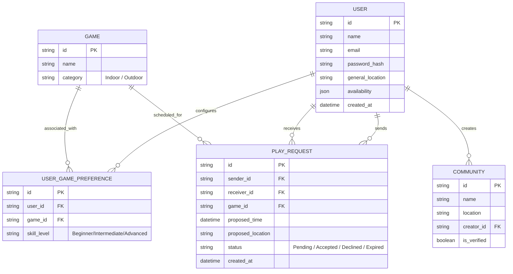

# Requirement Analysis Report
## Local Sports & Indoor Games Partner Finder Platform

This document presents a structured requirement analysis of the Local Sports & Indoor Games Partner Finder Platform. It outlines the scope, functional and non-functional requirements, user roles, business rules, edge cases, and lists critical ambiguities that require clarification before development.

---

## 1. Executive Summary & Overview
The **Local Sports & Indoor Games Partner Finder Platform** is a community-focused web application designed to connect local players of indoor and outdoor games (e.g., chess, badminton, carrom, table tennis). It aims to solve coordination challenges and reduce social isolation by facilitating physical and mental recreation in residential complexes, clubhouses, and local grounds.

---

## 2. User Roles & System Actors

We identify three main user roles:

| Role | Description | Access & Capabilities |
| :--- | :--- | :--- |
| **General User** | A local resident looking for game partners. | Register/login, manage profile, set game preferences & availability, search nearby players, send/receive play requests, view history. |
| **Community Organizer (Optional)** | A representative of a housing society, club, or group. | All General User features, plus creating society/community groups, posting open play requests, scheduling recurring sessions. |
| **System Admin** | Platform administrator. | Manage users, verify community groups, manage game categories, monitor system activity, handle reports/abuse. |

---

## 3. Functional Requirements

### 3.1 User Management & Profile
* **FR-1.1: Registration & Auth**: Users must be able to sign up and log in securely.
* **FR-1.2: Profile Customization**: Users can build profiles with:
  * Name
  * Gender identity (with safety preferences, e.g., option to only display profile to/match with same-gender players)
  * Location (approximate or neighborhood-level)
  * Preferred games (multi-select: Chess, Carrom, Cards, Badminton, Table Tennis, etc.)
  * Skill level per game (Beginner, Intermediate, Advanced)
  * Weekly availability (days of week and time blocks like Morning, Afternoon, Evening)
* **FR-1.3: Playing Location Preference**: Users can designate preferred venues:
  * Home (requires strict privacy/consent)
  * Society Clubhouse
  * Local Ground/Park

### 3.2 Discovery & Matchmaking
* **FR-2.1: Partner Search**: Users can search for other players based on:
  * Game type
  * Location (visual map search via Leaflet/OpenStreetMap or distance radius)
  * Availability match
  * Skill level match
* **FR-2.2: Send/Receive Play Requests**: A user can send a request to a discovered player for a specific game, date, time, and location.
* **FR-2.3: Request Management**: Recipients can accept or decline play requests.
* **FR-2.4: Confirmation & Contact Reveal**: Once accepted, the status changes to "Confirmed", and the system automatically reveals the contact details (email and phone number) of both players to enable offline coordination. Users can view match history.

### 3.3 Community / Group Management (Optional/Phase 2)
* **FR-3.1: Group Creation**: Organizers can create a society or neighborhood group.
* **FR-3.2: Open Play Requests**: Posting a bulletin-board-style play request open to all group members.
* **FR-3.3: Recurring Sessions**: Scheduling weekly or bi-weekly game slots for the community.

### 3.4 Administration
* **FR-4.1: User Management**: View, suspend, or delete user accounts.
* **FR-4.2: Game Management**: Admin can add/remove sports and indoor games categories.
* **FR-4.3: Moderation & Reports**: Manage flag reports of inappropriate behavior or fake profiles.
* **FR-4.4: Community Verification**: Verify and approve newly created society/club groups.

---

## 4. Non-Functional Requirements

* **NFR-1: Performance (Search Latency)**: Matchmaking search results must load in **< 3 seconds** under normal network conditions.
* **NFR-2: Security & Privacy**:
  * Safe handling of user credentials (bcrypt hashing, JWT or session auth).
  * Absolute masking of exact home addresses until a mutual match is confirmed (or keeping it completely hidden and using neighborhood markers).
* **NFR-3: Usability (Accessibility & Responsiveness)**:
  * Mobile-responsive layout (since players will use it on-the-go at clubhouses and local grounds).
  * Intuitive, large UI touchpoints suitable for all age groups (children to senior citizens).
* **NFR-4: Scalability**: Database and matchmaking queries must scale efficiently as users span multiple cities and locations.

---

## 4.5. Project Assumptions, Constraints & Out-of-Scope

### Assumptions
* Users will provide accurate location and availability information.
* The platform is used solely for casual, friendly, and non-commercial games.
* Participation in community groups is completely voluntary.

### Constraints
* **No real-time chat or calling in Phase 1**: All matching and initial coordination must happen via request actions or safe contact display.
* **Limited moderation initially**: System relies on basic admin monitoring and report flags.
* **Fixed development timeline**: Feature creep must be avoided to meet project dates.

### Out of Scope for Phase 1
* Native mobile applications (iOS/Android).
* Tournament organization, bracket systems, and scoring/ranking engines.
* Paid coaching, lesson booking, or professional training services.

---

## 4.6. Key Performance Indicators (KPIs)
To track platform health and match efficiency, the admin system should log and display:
* **Total Registered Users**: Growth of the user base.
* **Active Play Requests**: Total requests created within a rolling window.
* **Successful Match Rate**: Percentage of play requests that are accepted.
* **Monthly Active Users (MAU)**: General platform engagement.
* **Repeat Engagement Rate**: Percentage of users who participate in more than one confirmed match.

---

## 5. Business Rules

1. **Mutual Consent for Matches**: No contact info or specific coordination details should be visible to a player until they accept a play request.
2. **Availability Alignment**: Matchmaking searches must prioritize users with overlapping free slots.
3. **Skill Categorization**: A user might be "Advanced" at Chess but a "Beginner" at Badminton. The skill level parameter must be game-specific, not profile-wide.
4. **Distance Boundaries**: Search results should be capped by a logical radius (e.g., 5-10 km max) to keep matches genuinely local.

---

## 6. Key Edge Cases & Mitigation

| Edge Case | Potential Impact | Mitigation Strategy |
| :--- | :--- | :--- |
| **Multiple Conflicting Requests** | User accepts two play requests for the same time slot. | Alert the user when accepting a request that conflicts with an already confirmed match. Automatically decline or warn other pending requests for that slot. |
| **Expired Requests** | A request is sent but never accepted/declined, cluttering the inbox. | Implement a 24-hour expiration threshold or auto-archive requests whose proposed play time has passed. |
| **Location Changes** | A user travels and searches, but their profile has a fixed home location. | Allow a temporary "search near me" using browser geolocator, without permanently changing the profile's home location. |
| **Safety in "Home" Matches** | Safety hazards when visiting a stranger's home for a board game. | Warn users when choosing "Home" as a location. Recommend public clubhouses or local grounds for initial matches. |
| **Spamming Requests** | A user repeatedly sends requests to another user who ignores them. | Limit consecutive unanswered requests to the same user to 1 or 2, and provide a "Block" option. |

---

## 7. Aligned Technical Decisions

Based on user feedback, the following design ambiguities have been resolved:

1. **User Demographics & Safety Filters**: The platform is open to all general users. To support safety and address the original "User (Women) Features" prompt, users can optionally specify their gender and toggle a privacy preference to only match/interact with players of the same gender.
2. **Offline Coordination**: Since there is no real-time chat in Phase 1, the system will automatically display contact details (email/phone number) to both parties *only* after a play request is mutually accepted.
3. **Map Integration**: We will integrate **Leaflet/OpenStreetMap** (free, no API key required) to allow users to visually pin their neighborhood location and view nearby players on a search map.

---

## 8. Core Data Model & Entities

---

## 9. Proposed High-Level User Flow

```mermaid
sequenceDiagram
    autonumber
    actor Alice as User A (Sender)
    actor Bob as User B (Receiver)
    participant App as Platform UI/Server

    Note over Alice, App: Matchmaking & Request
    Alice->>App: Search (Game: Chess, Loc: Society Club, Skill: Intermediate)
    App->>Alice: Display Matching Profiles (including Bob)
    Alice->>App: Send Play Request to Bob (Time: Sat 4PM, Loc: Clubhouse)
    App->>Bob: Notify of incoming Play Request

    Note over Bob, App: Request Evaluation
    alt Bob Accepts
        Bob->>App: Accept Request
        App->>Alice: Notify confirmation
        App->>Bob: Reveal Alice's safe contact details (e.g. Email/WhatsApp)
        App->>Alice: Reveal Bob's safe contact details (e.g. Email/WhatsApp)
    else Bob Declines
        Bob->>App: Decline Request
        App->>Alice: Notify request declined (with no contact details revealed)
    end
```

---

## 10. Architectural Recommendations

We recommend a clean, responsive layout built using the following stack:
1. **Frontend**: **React.js** or **Next.js** combined with **Tailwind CSS**. A responsive layout is critical because users will access the tool while on local grounds or in clubhouses.
2. **Backend**: **Node.js with Express.js** or a unified **Next.js API route layer** to simplify deployment and minimize cross-origin resource sharing (CORS) issues.
3. **Database**: **MongoDB** is excellent for storing flexible JSON objects for user availability (e.g., daily time ranges) and game-specific preferences. Alternatively, **PostgreSQL** is highly robust for location-based spatial queries using PostGIS. For Phase 1, MongoDB with basic distance calculation coordinates (2dsphere index) will be fast and easy to implement.
4. **Geolocation**: Simple text-based society/neighborhood lookup, backed by browser geolocation coordinates, to protect user privacy.

---

### Next Steps & Feedback
Please review the ambiguities in **Section 7** (particularly regarding the **User (Women)** references). Once you clarify these points and approve this plan, we will proceed to map out the application files and initialize the project.
